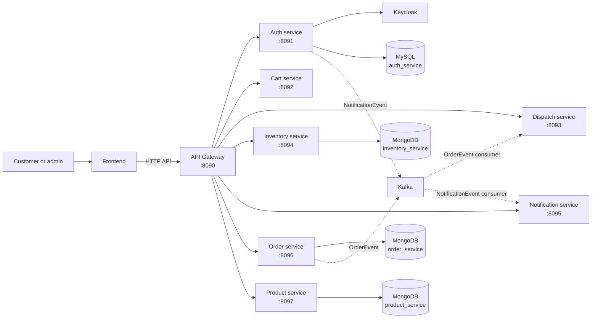
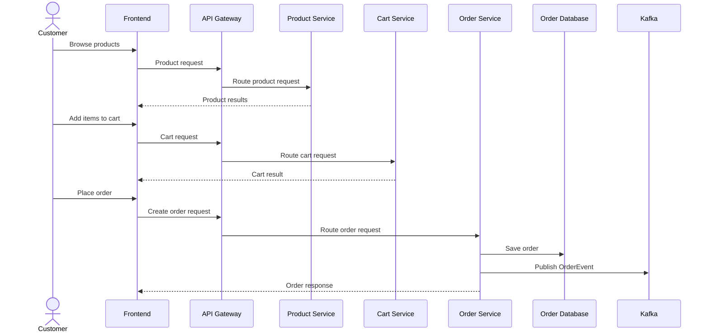
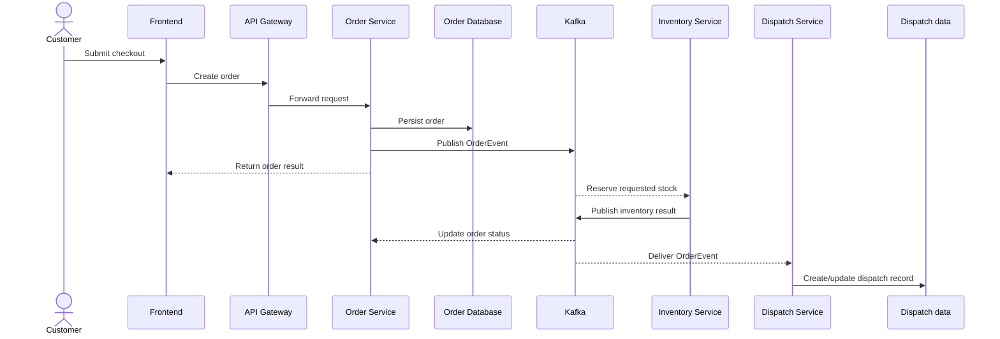
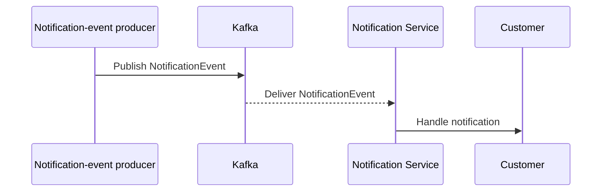
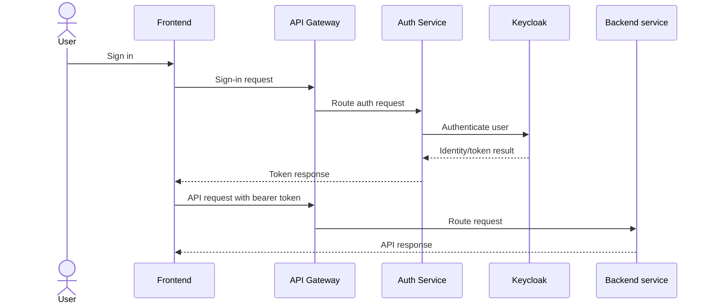

# Backend microservices: purpose and flows

This guide is for both people using the e-commerce application and developers
working on its backend. It describes the services wired in `docker-compose.yaml`
and the request/event paths between them.

## At a glance

The browser sends API requests to the gateway rather than choosing backend
services itself. The gateway exposes the consolidated API documented in the
gateway's OpenAPI page and routes requests to services using configured URLs.
Kafka carries events for work that does not need to be completed as part of the
original HTTP request.

## Local URLs and ports

These are the host addresses published by `docker-compose.yaml`. The
application services can be reached directly for development, but the frontend
normally sends API requests through the gateway.

| Service | Local URL / address | Port |
| --- | --- | ---: |
| Frontend (Vite default) | `http://localhost:5173` | 5173 |
| API Gateway | `http://localhost:8090` | 8090 |
| Auth Service | `http://localhost:8091` | 8091 |
| Cart Service | `http://localhost:8092` | 8092 |
| Dispatch Service | `http://localhost:8093` | 8093 |
| Inventory Service | `http://localhost:8094` | 8094 |
| Notification Service | `http://localhost:8095` | 8095 |
| Order Service | `http://localhost:8096` | 8096 |
| Product Service | `http://localhost:8097` | 8097 |
| Keycloak | `http://localhost:8081` | 8081 |
| Kafka UI | `http://localhost:8085` | 8085 |
| Kafka (host client connection) | `localhost:9092` | 9092 |
| MongoDB | `localhost:27017` | 27017 |
| MySQL | `localhost:3306` | 3306 |

Vite may select another port if 5173 is occupied; use the URL printed by
`npm run dev`. Database and Kafka addresses are connection endpoints, not
browser pages. Inside the Compose network, services use their Compose service
names and container ports instead of `localhost`.

## What each service does

| Service | Purpose |
| --- | --- |
| **API Gateway** | Application entry point for backend HTTP APIs. Routes requests to the appropriate service and serves the consolidated API documentation. |
| **Auth Service** | Account and user APIs, including sign-in/token operations and user-profile management. Uses Keycloak for identity and MySQL for its configured auth-service database. |
| **Product Service** | Product catalog APIs, including browsing and searching products. Uses the `product_service` MongoDB database. |
| **Cart Service** | Cart APIs for the customer's selected products before checkout. |
| **Order Service** | Creates and manages orders. Stores orders in the `order_service` MongoDB database and publishes order events. |
| **Inventory Service** | Inventory/stock APIs and inventory data, configured with the `inventory_service` MongoDB database. |
| **Dispatch Service** | Dispatch APIs and records. Listens for order events so dispatch work can be recorded separately from order creation. |
| **Notification Service** | Listens for notification events and handles notification work asynchronously. |
| **Keycloak** | Identity provider used for authentication and token issuance. |
| **Kafka** | Message broker for asynchronous event delivery between services. |
| **MongoDB / MySQL** | Persistence infrastructure configured for the services; service data is kept in named databases. |
| **Kafka UI** | Local operations interface for inspecting Kafka. It is not part of the customer request path. |

## Local observability

For an end-to-end explanation of logs, metrics, traces, dashboard authoring,
and verification steps, see [OBSERVABILITY.md](OBSERVABILITY.md).
The provisioned **JVM & Service Runtime** dashboard is at
`http://localhost:3001/d/jvm-service-runtime/jvm-service-runtime`.
Infrastructure dashboards are available at
`http://localhost:3001/d/docker-containers/docker-containers` (Docker),
`http://localhost:3001/d/mysql-server/mysql-server` (MySQL), and
`http://localhost:3001/d/mongodb-server/mongodb-server` (MongoDB).

The Compose stack includes Prometheus for service metrics, Grafana Alloy for
shipping the existing service log files to Loki, OpenTelemetry Collector for
OTLP traces, Tempo for trace storage, and Grafana for exploring all three
signals. The Spring services expose Micrometer Prometheus metrics and use the
Spring Boot OpenTelemetry starter to export traces to the collector. Local
configuration samples every request by default so trace/span IDs appear in
logs; override `OTEL_TRACES_SAMPLER_ARG` to reduce sampling when needed. Spring
MVC server requests, injected `RestClient.Builder` calls, and Kafka
producers/consumers are instrumented; trace context is propagated over HTTP and
Kafka. OTLP metric export is disabled because Prometheus scrapes
`/actuator/prometheus` and the Collector is configured for traces only. No
application request, database, or Kafka flow depends on the observability
containers.

Start the stack with `docker compose up -d`. The interfaces and OTLP receiver
are bound to loopback on the host:

| Component | Host URL / port | Purpose |
| --- | --- | --- |
| Grafana | `http://localhost:3001` | Explore metrics, logs, and traces; provisioned datasources are Prometheus, Loki, and Tempo. |
| Prometheus | `http://localhost:9090` | Query metrics and check targets at `/targets`. |
| Loki | `http://localhost:3100` | Log API; normally queried through Grafana. |
| Tempo | `http://localhost:3200` | Trace API; normally queried through Grafana. |
| OTLP gRPC | `localhost:4317` | OpenTelemetry Collector receiver. |
| OTLP HTTP | `localhost:4318` | OpenTelemetry Collector receiver; apps use `/v1/traces`. |

The provisioned **E-commerce Services Overview** dashboard is available at
`http://localhost:3001/d/ecom-services-overview/e-commerce-services-overview`.
It shows Prometheus target health, successful order/user/login/registration
request counts, HTTP request flows and errors, Kafka producer/consumer activity,
and recent Loki logs. Use **Explore traces in Tempo** in the dashboard header
to search distributed traces across HTTP and Kafka. Business counts are
successful requests observed by the gateway over the selected time range; they
are not lifetime database totals. Kafka activity panels require the services to
be running with Spring Kafka observations enabled.

All observability host ports are bound to loopback. Prometheus scrapes the
published host ports via `host.docker.internal`, so it works whether Spring
services are started from the IDE on the host or as Compose containers.
Alloy's HTTP server listens on port `12345` inside the Compose network only; it
is not published to the host.

Prometheus scrapes `/actuator/prometheus` from all Spring services over the
Compose network. The endpoint is permitted without a user token for scraping;
other actuator authorization remains unchanged. Logs are read from the shared
`./logs` directory and pushed to Loki. Grafana's initial local-development login
defaults to `admin` / `admin`; set `GRAFANA_ADMIN_USER` and
`GRAFANA_ADMIN_PASSWORD` before starting the stack. The Grafana port is
loopback-only; do not expose this default setup to an untrusted network.
Prometheus retains seven days of metrics, Loki seven days of logs, and Tempo
three days of traces. Data persists in named Docker volumes.

Product variant stock is synchronized between Product Service and Inventory
Service through Kafka. Product stock edits and imports publish catalog stock
changes; inventory reservations and manual inventory adjustments publish the
resulting available quantity back to the catalog. Admins can view and update
variant inventory at `/admin/inventory`. Use **Update from product stock** to
reconcile inventory quantities for existing product variants.
The inventory table supports searching product names, human-readable product
codes, IDs, and variants, filtering by quantity range and last-updated date,
sorting by product code/name, variant, quantity, or last-updated date in either
direction, and sending an individual variant's current inventory quantity back
to the product catalog with **Update product stock**.
Use **Refresh product codes** to backfill catalog names and product codes on
existing inventory rows without changing their quantities.

The admin sync endpoint is `POST /api/products/inventory/sync`. It publishes
the current stock count for each product variant, creating missing inventory
records and updating existing ones. This explicit reconciliation resets
available inventory to the product catalog count; run it when no orders are
being processed. Product stock edits and imports publish stock-set events,
while order reservations/cancellations and admin inventory edits publish
available-quantity events back to Product Service. These cross-service updates
are asynchronous, so both services must be running with Kafka available. Use
the Inventory page's Refresh action after reconciliation to load the updated
records.
For one variant, `POST /api/inventory/sync-product?productId=...&variantId=...`
publishes the inventory quantity to Product Service; a successful response
confirms Kafka accepted the event, not that the catalog consumer has finished
processing it.
`POST /api/products/inventory/metadata-sync` refreshes product names and codes
in inventory without resetting quantities.
The product catalog table also supports ascending or descending sorting by
name, product code, price, stock, and dates.
Catalog filters include product type, price range, discount-percentage range,
an exact color-variant count, and an optional stock comparison (`eq`, `gte`,
`lte`, `gt`, `lt`, or `ne`) with a configurable value that defaults to 10 units.
The color-count filter matches the number of variant entries on a product.
Inventory filters provide the same optional comparison operators for each
variant's available quantity, alongside the quantity range filters.

Service ports and container wiring above reflect the local Docker Compose
configuration. Applications may use different hostnames/ports in other
environments.

## Customer journey: browse, cart, and checkout

The HTTP response confirms the order-service operation. Kafka consumers perform
their work independently, so dispatch processing is not the same request as
checkout.

## Order creation and dispatch

**In plain language:** the Order Service is responsible for accepting and
storing the order. It initially reports `PENDING_INVENTORY` while the Inventory
Service asynchronously reserves stock. The Order Service changes the status to
`CONFIRMED`, `PARTIALLY_CONFIRMED`, or `REJECTED` when it receives the inventory
result. The customer and staff order views refresh these in-progress statuses
automatically. Dispatch records are also produced asynchronously and may not be
visible at the exact moment the checkout response is returned.

Admins and managers can request cancellation from order management while an
order is pending, confirmed, partially confirmed, or rejected. Cancellation
updates the order and dispatch status through Kafka and restores any stock
reserved for that order.

### Orders containing unavailable items

Inventory reservations are evaluated per order line. Available lines are
reserved and remain eligible for dispatch; unavailable lines are reported as
`REJECTED` in the order's `itemResults`. When at least one line is reserved and
another is unavailable, the order status is `PARTIALLY_CONFIRMED`. The dispatch
record contains only the successfully reserved lines, so unavailable products
are not included in fulfillment. If no line can be reserved, the order status
is `REJECTED`. Cancelling a partially confirmed order restores only the stock
that was actually reserved.

## Notifications

Notification events are a separate event contract from the dispatch
`OrderEvent`:

The notification service's listener consumes `NotificationEvent`; the dispatch
listener consumes `OrderEvent`. Do not assume that creating an order directly
triggers a customer notification: that requires the order flow to publish a
notification event (or another service to translate the order event). Check
the producer and event payload before changing or documenting that behavior.

## Sign-in and protected requests

Use the gateway's authentication endpoints and OpenAPI document as the
authoritative reference for the available paths and request/response shapes.
The deployment wires Keycloak as the identity provider; token validation and
authorization rules are defined by the individual service security
configuration.

## Developer notes

- **Synchronous path:** frontend → API Gateway → service → response.
- **Asynchronous path:** producer → Kafka → event listener → consumer-side work.
- Keep each service's responsibility and data ownership clear; avoid using
  another service's database as an integration API.
- Event delivery and HTTP completion are separate. Consumers should be safe to
  process events without assuming the publisher is still waiting.
- `OrderEvent` and `NotificationEvent` are distinct event types. Verify the
  producer, consumer, and payload when changing event-driven behavior.
- See `docker-compose.yaml` for local service ports and infrastructure
  configuration, and the API Gateway's OpenAPI document for endpoint details.
